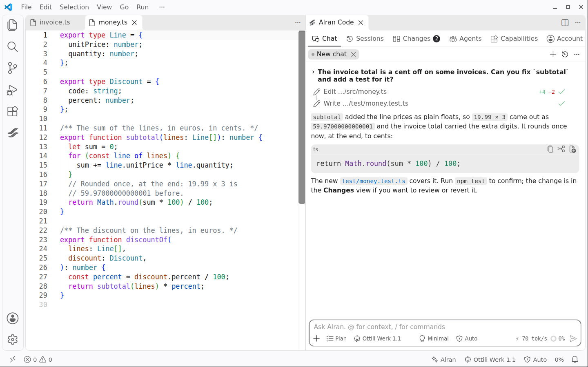
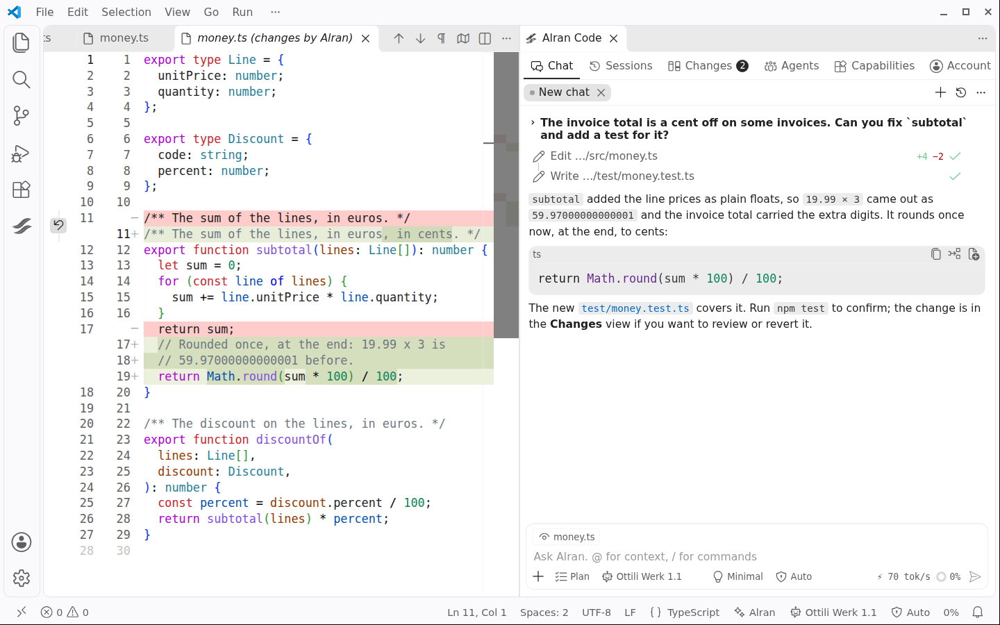
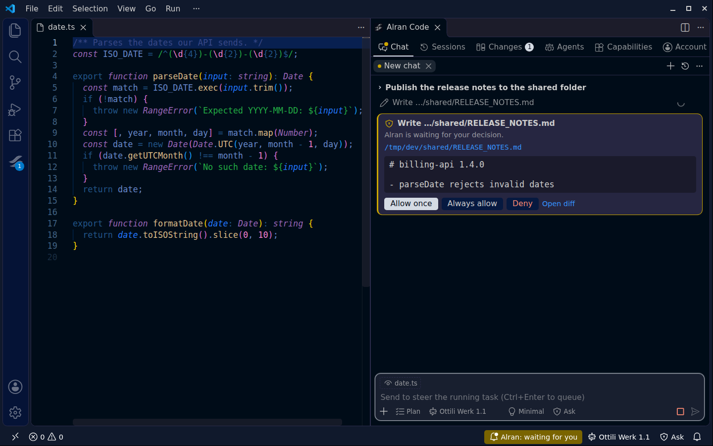
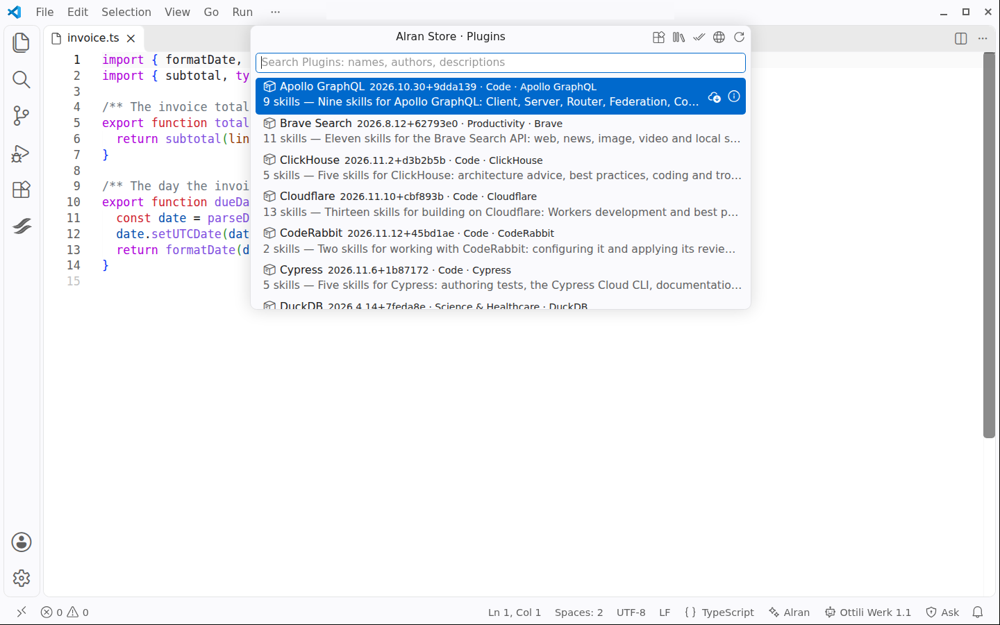
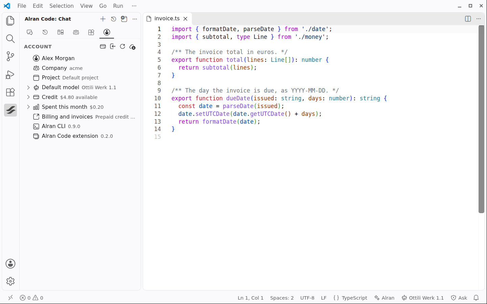
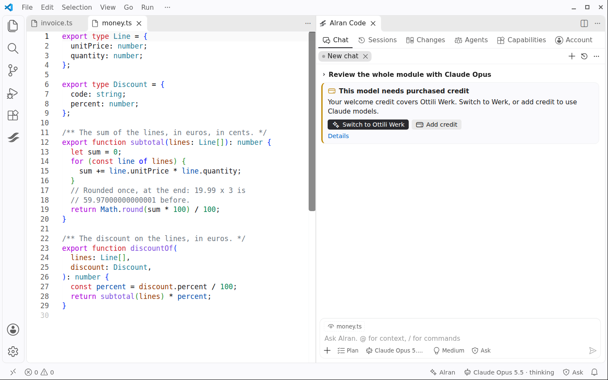

# Alran Code for VS Code

**The whole coding agent, in the editor.** One agent for the terminal and for VS Code: the same sessions, the same Skills, the same Plugins, the same rules. Describe a task — Alran plans it, edits the files, runs your tests and keeps going until it works.



## What you get

- **One agent, two surfaces.** The extension is the front end of the real Alran Code CLI. Tools, permissions, Skills, Plugins, MCP servers, sub-agents, Goals and sessions behave exactly as they do in the terminal, because it *is* the same agent — not a second implementation that drifts away from the one you use on the command line.
- **One chat, six tabs.** **Chat**, **Sessions**, **Changes**, **Agents**, **Capabilities** and **Account** along the top of the panel, in the side bar or in an editor tab. A badge counts changed files and running sub-agents.
- **A store that is part of the product.** The **Plugin Store** and the **Skill Library** are built in. Downloads are checked against the store's digest, and a Plugin that runs commands is shown to you in full before it is installed.
- **An account with models and credit.** Ottili Werk, Claude (on your own Anthropic key) or your own provider — with welcome credit, spending per model and invoices in the **Account** view.
- **You stay in control.** Plan Mode plans before Alran touches anything. Permissions arrive as cards with a preview and an **Open diff** button. Every edit is a real diff, and every change can be reverted.
- **It runs where your code runs.** Remote SSH, WSL, dev containers, Codespaces — the CLI goes on the machine that holds your code.

## Get started

> **The Alran Code CLI must be installed.** The extension is the editor front end of the `alran` command and does not work without it. It needs the Alran CLI **0.9.0 or newer** on the machine where your code is — your computer, or the remote host over SSH, WSL or containers. If the CLI is missing, the extension says so at startup and offers to install it.

1. **Install the Alran CLI** (once per machine):

   ```sh
   npm install -g alran                               # any platform with Node.js 22.19+
   curl -fsSL https://alran.dev/install.sh | bash     # macOS, Linux, WSL; brings its own Node.js
   ```

   Without the CLI the extension cannot start; it notices and offers to install it for you.

2. **Open the Alran panel** in the activity bar (`Ctrl+Alt+A`, `Cmd+Alt+A` on macOS).

3. **Sign in.** The browser opens the Ottili sign-in page; in a remote window you confirm a short code instead. New accounts get welcome credit for Ottili Werk; Claude runs on your own Anthropic API key. You can also use an Ottili API key, or bring your own provider without any account.

4. **Describe a task.** For example: *"Add a test for the date parser and make it pass."*

## The chat

Streaming answers and reasoning, tool calls with inline diffs, several sessions in tabs, and a chat that can also open as an editor tab. `@` adds files and Plugins, `Ctrl+Alt+L` adds the selection, images go in by paste or drop, and the current file is shared unless you turn it off.

While Alran works, **Enter** steers the running task, **Ctrl+Enter** queues the next message and **Esc** stops. Queued messages can be edited, removed or sent right away. What you typed stays where you left it: switch tabs, switch sessions, even restart the agent — the draft is still there. Runs of reads and searches fold into one line, answered permissions shrink to a line, and a **Jump to latest** button brings you back to the end.

## You stay in control

Every edit opens as a real diff next to your code, and the **Changes** tab lists everything a session changed, with per-file or full revert. Plan Mode (`Shift+Tab`) lets Alran plan before it touches anything. A dot on the **Chat** tab tells you on every page that Alran is working (blue) or waiting for your answer (yellow); when the request is out of sight, **Alran is waiting for you** takes you to it.



Permission requests appear as cards with a preview and an **Open diff** button; questions appear as forms. In the default mode Alran asks before it writes outside your project.



## Plugins and Skills

The **Plugin Store** and the **Skill Library** are built in. Open them with **Alran: Browse Plugin Store…**, **Alran: Browse Skill Library…**, the *Plugins* group of the Capabilities view, or `/plugin` and `/skills library`.



- **Plugins** are packages of Skills, MCP servers, connectors and hooks; **Skills** are single instructions with a `SKILL.md`. The Library is the same catalogue seen as single Skills, grouped by the store's own groups.
- **Enter** installs, or updates when the store has a newer version; the buttons on a row show details, switch a Plugin on or off and remove it.
- A Plugin that runs commands or connects to services is **never installed straight away**: every command, hook and connector is listed first, and nothing is written until you approve.
- Every download is checked against the SHA-256 and content digest in the store's index. Alran reads the store Ottili hosts by default; **Alran: Add Plugin Store…** adds another one. Only add stores you trust: whoever controls a store controls what it lists.
- Skills and Plugins load when a chat starts, so open a **New Chat** after installing.

## Models, credit and your account

The **Account** view shows who you are signed in as, your company and project, your default model, your credit and this month's spending. Switch company or project, add credit and open invoices from there.



Alran runs on **Ottili Werk** (the default), on **Claude** or on **your own provider**. The model picker shows every model and whether you can use it now; the star makes a model the default for new sessions.

**Claude runs on your own Anthropic API key.** Add it once in the Ottili AI Platform (Settings → Provider keys; **Alran: Add or Replace Your Anthropic Key** opens the page): it is checked, stored encrypted and used only for your requests. Anthropic bills you directly — Ottili charges nothing for Claude and adds no fee, and the Account view lists Claude's tokens as *billed by Anthropic*. Werk is billed by Ottili from your credit. With your own provider configured in Alran the requests go straight to that provider, and Ottili does not meter them.

## Errors you can act on

When something goes wrong, Alran says what happened and offers the next step: add your Anthropic key when Claude needs it, switch to Ottili Werk, add credit, sign in again, try again after a rate limit, or compact a conversation that no longer fits the context. The original message stays one click away under **Details**.



## Built into the editor

- **`@alran` in the VS Code Chat view** — ask Alran from the editor's own chat; the conversation continues in the Alran panel whenever you like.
- **Accounts menu** — your Ottili account, with sign-out, next to your other accounts.
- **Terminal profile** — *Alran Code* opens the full terminal UI.
- **Quick Fix and context menus** — *Explain*, *Fix* and *Fix problems in this file*; *Add to chat* from the Explorer, editor tabs and the terminal.
- **Status bar** — model, permission mode and context usage of the current session, plus account and credit at a glance. It turns yellow when Alran waits for you.
- **Command palette** — *Alran: Show Changes*, *Show Sessions*, *Show Sub-Agents* and *Show Skills, MCP Servers, Plugins and Providers* open the tabs of the chat directly.
- **Every command of the terminal** — type `/` or run **Alran: Slash Commands…**. All slash commands of the terminal UI work in the chat; [docs/feature-parity.md](docs/feature-parity.md) lists how each one is implemented.

Resume and fork sessions, ask side questions without interrupting a running task (`/btw`), set Goals with token budgets, and watch sub-agents in the **Agents** view. The **Capabilities** view lists Skills and MCP servers, manages installed Plugins and adds, tests and removes model providers.

## Keyboard shortcuts

| macOS | Linux | Windows | Action |
| --- | --- | --- | --- |
| `Cmd+Alt+A` | `Ctrl+Alt+A` | `Ctrl+Shift+Alt+A` | Open the chat |
| `Cmd+Alt+N` | `Ctrl+Alt+N` | `Ctrl+Shift+Alt+N` | New session |
| `Cmd+Alt+L` | `Ctrl+Alt+L` | `Ctrl+Shift+Alt+L` | Add the selection to the chat |
| `Cmd+Alt+E` | `Ctrl+Alt+E` | `Ctrl+Shift+Alt+E` | Explain the selection |
| `Cmd+Alt+M` | `Ctrl+Alt+M` | `Ctrl+Shift+Alt+M` | Choose a model |
| `Cmd+Alt+P` | `Ctrl+Alt+P` | `Ctrl+Shift+Alt+P` | Plan Mode on or off |
| `Cmd+Alt+Backspace` | `Ctrl+Alt+Backspace` | `Ctrl+Alt+Backspace` | Stop the running task |

On Windows, `Ctrl+Alt` is the same key as `AltGr`, which types characters such as `@`, `€`, `µ` or `ł`; the Windows shortcuts add `Shift` so they never get in the way of typing. In the composer: `Shift+Tab` toggles Plan Mode, `Alt+M` cycles the permission mode, `Esc` stops and `↑` recalls earlier messages.

## Settings

| Setting | Purpose |
| --- | --- |
| `alran.executablePath`, `alran.nodePath` | Which CLI and Node.js to run |
| `alran.autoConnect` | Start the agent and open a session as soon as the chat is shown |
| `alran.env` | Extra environment for the agent, such as `ALRAN_DATA_DIR` or `ALRAN_STORE_URL` |
| `alran.systemPrompt`, `alran.systemPromptFile` | Replace the identity prompt for the session |
| `alran.appendSystemPrompt`, `alran.appendSystemPromptFile` | Add to the identity prompt |
| `alran.mcpServers` | MCP servers added to sessions opened from this editor |
| `alran.chat.enterWhileRunning` | Whether Enter steers or queues during a task |
| `alran.chat.sendShortcut`, `alran.chat.showThinking` | Composer and transcript behaviour |
| `alran.context.includeActiveFile` | Share the current file by default |
| `alran.notifications.when`, `alran.notifications.events` | Notifications, matching the terminal UI's options |
| `alran.confirmFullAccess` | Confirm before enabling Full Access |

Providers, permission rules and everything else stay in Alran's own `config.yaml` (**Alran: Open config.yaml**), shared with the terminal UI.

## Remote development and other editors

The extension runs where your code is: over Remote SSH, in WSL, in dev containers and in Codespaces, install the CLI on that machine. Sign-in then uses a code you confirm in your local browser. Alran Code also runs in Cursor, Windsurf and VSCodium (from Open VSX); `@alran` needs an editor with the VS Code Chat view, everything else works the same.

## Privacy and security

- The extension sends no telemetry and talks only to the local `alran` process. **Alran: Show Telemetry Status** shows what the CLI reports.
- Your Ottili session stays with the CLI. The Accounts menu shows your name, never the credential, and API keys reach the CLI through its environment or standard input, never its command line.
- With your own provider, requests go directly to that provider; Ottili does not see, meter or bill them.
- Installing from the Plugin Store contacts the store's host and nothing else; what is installed never leaves your machine. A Plugin that runs commands waits for your approval.
- The extension is disabled in Restricted Mode, because it runs an agent that can read files and execute commands. Full Access asks for confirmation first.

## Troubleshooting

| Problem | What to do |
| --- | --- |
| *Alran CLI not found* | Run **Alran: Install or Locate the Alran CLI…**, or set `alran.executablePath`. |
| *Alran CLI is older than this extension needs* | Run **Alran: Update Alran CLI** or `npm install -g alran`. The extension needs 0.9.0 or newer. |
| *Alran needs a newer Node.js* | The CLI needs Node.js 22.19 or newer (22.x), 24.2+, 25 or 26. The install script brings its own; with npm, update Node.js or set `alran.nodePath`. |
| Sign-in does not finish | Use **Alran: Sign In with a Code**, which works without a callback to this machine. |
| *Claude needs your Anthropic key* | Claude runs on your own Anthropic API key. Add it with **Alran: Add or Replace Your Anthropic Key**, or switch to Ottili Werk, which your welcome credit covers. |
| The Plugin Store is empty | The store's host is not reachable from this machine. Check the network, or add another store with **Alran: Add Plugin Store…**. |
| A Plugin or Skill does not show up | Skills and Plugins load when a chat starts. Open a **New Chat** after installing. |
| Anything else | **Alran: Show Logs** has the details. Reload with **Alran: Reload Agent**. |

Questions and bug reports: [github.com/Alran-AI/vscode/issues](https://github.com/Alran-AI/vscode/issues). More at [alran.dev](https://alran.dev). The extension is MIT licensed; third-party notices are in [THIRD_PARTY_NOTICES.md](THIRD_PARTY_NOTICES.md).
