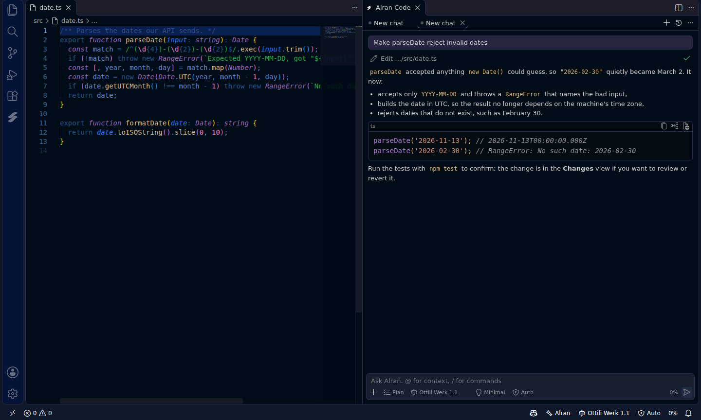
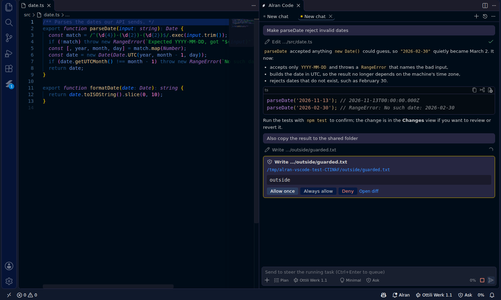
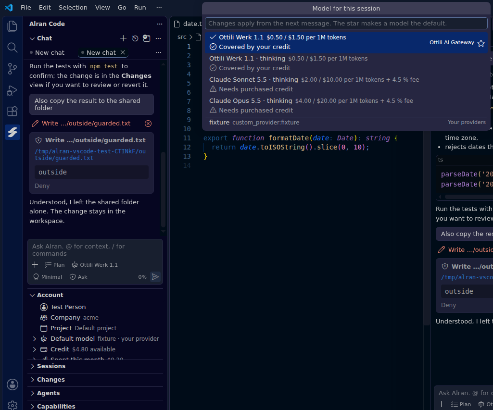
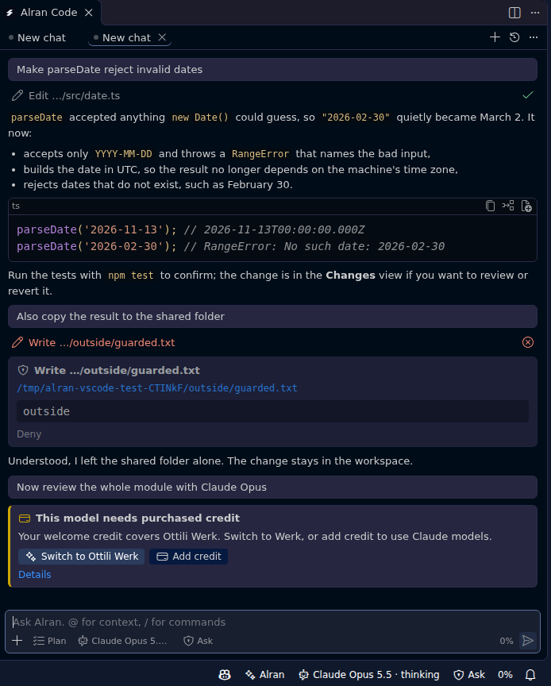

# Alran Code for VS Code

Alran Code is Ottili's AI coding agent. Describe a task, and Alran plans it, edits your files, runs commands and tests, and keeps going until it works. Use it with **Ottili Werk**, **Claude Sonnet 5.5 and Opus 5.5**, or your own model provider.



The extension is a full editor front end for the real Alran Code CLI. Tools, permissions, Skills, Plugins, MCP servers, sub-agents, Goals and sessions behave exactly as they do in the terminal, because the same agent runs them.

## Requirements

> **The Alran Code CLI must be installed.** The extension is the editor front end of the `alran` command and does not work without it. It needs the Alran CLI **0.2.0 or newer** on the machine where your code is (your computer, or the remote host over SSH, WSL or containers). If the CLI is missing, the extension says so at startup and offers to install it.

- VS Code 1.90 or newer, or Cursor, Windsurf, VSCodium
- The Alran Code CLI: `curl -fsSL https://alran.dev/install.sh | bash` (macOS, Linux, WSL) or `npm install -g alran` (any platform, Node.js 22.19+)
- An Ottili account, an Ottili API key, or your own model provider

## Get started

1. **Install the Alran CLI** (once per machine):

   ```sh
   curl -fsSL https://alran.dev/install.sh | bash     # macOS, Linux, WSL
   npm install -g alran                               # any platform with Node.js 22.19+
   ```

   Without the CLI the extension cannot start; it notices and offers to install it for you.

2. **Open the Alran panel** in the activity bar (`Ctrl+Alt+A`, `Cmd+Alt+A` on macOS).

3. **Sign in with your Ottili account.** The browser opens the sign-in page; in a remote window you confirm a short code instead. New accounts get welcome credit for Ottili Werk. You can also use an Ottili API key, or bring your own provider without any account.

4. **Describe a task.** For example: *"Add a test for the date parser and make it pass."*

## Features

### A chat that does the work

Streaming answers and reasoning, tool calls with inline diffs, several sessions in tabs, and a chat that can also open as an editor tab. `@` adds files and Plugins, `Ctrl+Alt+L` adds the selection, images go in by paste or drop, and the current file is shared unless you turn it off.

While Alran works, **Enter** steers the running task, **Ctrl+Enter** queues the next message and **Esc** stops. Queued messages can be edited, removed or sent right away.

### You stay in control

Permission requests appear as cards with a preview and an **Open diff** button; questions appear as forms. The **Changes** view lists everything a session changed, with a real diff and per-file or full revert. Plan Mode (`Shift+Tab`) lets Alran plan before it touches anything.



### Your account, models and credit

The **Account** view shows who you are signed in as, your company and project, your default model, your credit (welcome and purchased) and this month's spending per model. Switch company or project, add credit and open invoices from there. Your Ottili account also appears in the editor's **Accounts** menu.

The model picker shows each model's price and whether your credit covers it, and the star makes a model the default for new sessions.



| Model | Input / output per 1M tokens | Paid with |
| --- | --- | --- |
| Ottili Werk 1.1 (default) | $0.50 / $1.50 | welcome or purchased credit |
| Claude Sonnet 5.5 | $2.00 / $10.00 + 4.5 % service fee | purchased credit |
| Claude Opus 5.5 | $4.00 / $20.00 + 4.5 % service fee | purchased credit |

### Errors you can act on

When something goes wrong, Alran says what happened and offers the next step: switch to Ottili Werk when a model needs purchased credit, add credit, sign in again, try again after a rate limit, or compact a conversation that no longer fits the context. The original message stays one click away under **Details**.



### Built into the editor

- **`@alran` in the VS Code Chat view**: ask Alran from the editor's own chat; the conversation continues in the Alran panel whenever you like.
- **Accounts menu**: your Ottili account, with sign-out, next to your other accounts.
- **Terminal profile**: *Alran Code* in the terminal's profile list opens the full terminal UI.
- **Quick Fix and context menus**: *Explain*, *Fix* and *Fix problems in this file* on selections and diagnostics; *Add to chat* from the Explorer, editor tabs and the terminal.
- **Status bar**: model, permission mode and context usage of the current session, and account and credit at a glance.

### Sessions, Goals and sub-agents

Resume and fork sessions, ask side questions without interrupting a running task (`/btw`), set Goals with token budgets, and watch sub-agents in the **Agents** view. Every slash command of the terminal UI works in the chat; [docs/feature-parity.md](docs/feature-parity.md) lists how each one is implemented.

### Skills, Plugins, MCP and providers

The **Capabilities** view lists Skills and MCP servers, installs and manages Plugins, and adds, tests and removes model providers.

## Keyboard shortcuts

| macOS | Linux | Windows | Action |
| --- | --- | --- | --- |
| `Cmd+Alt+A` | `Ctrl+Alt+A` | `Ctrl+Shift+Alt+A` | Open the chat |
| `Cmd+Alt+N` | `Ctrl+Alt+N` | `Ctrl+Shift+Alt+N` | New session |
| `Cmd+Alt+L` | `Ctrl+Alt+L` | `Ctrl+Shift+Alt+L` | Add the selection to the chat |
| `Cmd+Alt+E` | `Ctrl+Alt+E` | `Ctrl+Shift+Alt+E` | Explain the selection |
| `Cmd+Alt+M` | `Ctrl+Alt+M` | `Ctrl+Shift+Alt+M` | Choose a model |
| `Cmd+Alt+P` | `Ctrl+Alt+P` | `Ctrl+Shift+Alt+P` | Plan Mode on or off |
| `Cmd+Alt+Backspace` | `Ctrl+Alt+Backspace` | `Ctrl+Alt+Backspace` | Stop the running task |

On Windows, `Ctrl+Alt` is the same key as `AltGr`, which types characters such as `@`, `€`, `µ` or `ł`; the Windows shortcuts add `Shift` so they never get in the way of typing. In the composer: `Shift+Tab` toggles Plan Mode, `Alt+M` cycles the permission mode, `Esc` stops and `↑` recalls earlier messages.

## Settings

| Setting | Purpose |
| --- | --- |
| `alran.executablePath`, `alran.nodePath` | Which CLI and Node.js to run |
| `alran.env` | Extra environment for the agent, such as `ALRAN_DATA_DIR` |
| `alran.systemPrompt`, `alran.appendSystemPrompt`, and their `File` variants | Launch-scoped prompt overrides |
| `alran.mcpServers` | MCP servers added to sessions opened from this editor |
| `alran.chat.enterWhileRunning` | Whether Enter steers or queues during a task |
| `alran.chat.sendShortcut`, `alran.chat.showThinking` | Composer and transcript behaviour |
| `alran.context.includeActiveFile` | Share the current file by default |
| `alran.notifications.when`, `alran.notifications.events` | Notifications, matching the terminal UI's options |
| `alran.confirmFullAccess` | Confirm before enabling Full Access |

Providers, permission rules and everything else stay in Alran's own `config.yaml` (**Alran: Open config.yaml**), shared with the terminal UI.

## Remote development and other editors

The extension runs where your code is: over Remote SSH, in WSL, in dev containers and in Codespaces, install the CLI on that machine. Sign-in then uses a code you confirm in your local browser.

Alran Code also runs in Cursor, Windsurf and VSCodium (from Open VSX). `@alran` needs an editor with the VS Code Chat view; everything else works the same.

## Privacy and security

- The extension sends no telemetry and talks only to the local `alran` process. **Alran: Show Telemetry Status** shows what the CLI reports.
- Your Ottili session stays with the CLI. The Accounts menu shows your name, never the credential, and API keys reach the CLI through its environment or standard input, never its command line.
- With your own provider, requests go directly to that provider; Ottili does not see, meter or bill them.
- The extension is disabled in Restricted Mode, because it runs an agent that can read files and execute commands. Full Access asks for confirmation first.

## Troubleshooting

| Problem | What to do |
| --- | --- |
| *Alran CLI not found* | Run **Alran: Install or Locate the Alran CLI…**, or set `alran.executablePath`. |
| *Alran needs a newer Node.js* | The CLI needs Node.js 22.19 or newer (22.x), 24.2+, 25 or 26. The install script brings its own; with npm, update Node.js or set `alran.nodePath`. |
| Sign-in does not finish | Use **Alran: Sign In with a Code**, which works without a callback to this machine. |
| *This model needs purchased credit* | Welcome credit covers Ottili Werk. Switch to Werk, or add credit in the Account view. |
| Anything else | **Alran: Show Logs** has the details. Reload with **Alran: Reload Agent**. |

Questions and bug reports: [github.com/Alran-AI/vscode/issues](https://github.com/Alran-AI/vscode/issues). More at [alran.dev](https://alran.dev).
